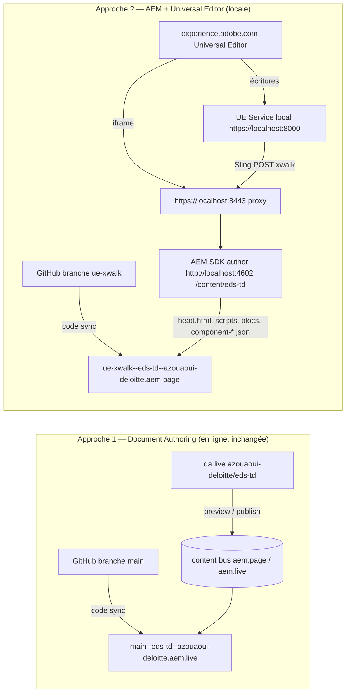

# Authoring AEM + Universal Editor (xwalk) en local — même migration TD, deuxième approche

Ce document décrit la seconde approche d'authoring démontrée sur la migration TD :
les **mêmes pages** et le **même code EDS** (blocs, CSS, scripts) sont édités dans
**AEM (SDK AEM as a Cloud Service local)** avec le **Universal Editor (UE)** —
« AEM authoring with Edge Delivery Services », alias *xwalk*.

L'approche Document Authoring (DA) reste la source du site en ligne et n'est pas modifiée.

## 1. Les deux approches côte à côte



| | Approche 1 — DA (production de la démo) | Approche 2 — AEM + UE (local) |
|---|---|---|
| Source du contenu | `https://da.live/#/azouaoui-deloitte/eds-td` | JCR du SDK local : `/content/eds-td/ca/fr/...` |
| Code | branche `main` | branche `ue-xwalk` (= `main` + support UE, rendu identique) |
| Rendu | `https://main--eds-td--azouaoui-deloitte.aem.live/ca/fr/...` | `https://localhost:8443/content/eds-td/ca/fr/....html` |
| Éditeur | DA (document) | Universal Editor (WYSIWYG, panneau de propriétés, arbre de contenu) |
| Images | `/media/td/...` dans DA | DAM `/content/dam/eds-td/...` |
| Publication | preview/publish aem.page / aem.live | **désactivée** (un SDK local n'est pas joignable par Edge Delivery ; voir §8) |

La configuration de site `azouaoui-deloitte/eds-td` (config service, source de contenu DA) n'est **pas** touchée :
une branche ne change que le *code* servi sur `ue-xwalk--eds-td--azouaoui-deloitte.aem.page` ;
AEM lit ce code (head.html, `/scripts`, `/blocks`, `component-*.json`) via son proxy
`/content/eds-td.resource/...`.

## 2. Ce que contient la branche `ue-xwalk`

| Fichier | Rôle |
|---|---|
| `models/_*.json`, `blocks/*/_*.json` | sources des modèles UE (définition, modèle de champs, filtres) par composant / bloc |
| `component-definition.json`, `component-models.json`, `component-filters.json` | fichiers fusionnés lus par AEM et le UE (`npm run build:json`) |
| `scripts/editor-support.js` | ré-décoration des blocs/sections après une modification dans le UE (boilerplate xwalk) |
| `scripts/editor-support-rte.js` | instrumentation richtext **sans** ajouter de `<div>` (les blocs et le CSS voient le même DOM que DA) |
| `scripts/dompurify.min.js` | assainissement du HTML renvoyé par le UE |
| `scripts/scripts.js` | `moveInstrumentation()`, `getContentRoot()`, export de `decorateButtons()` |
| `scripts/aem.js` | lecture de `section-metadata` rendu par AEM (DA l'applique côté serveur) ; pas de double décoration |
| blocs (`cards`, `accordion`, `tabs`, `hero`, `banner*`, `compare-cards`, `item-list`, `circle-links`, `big-number`, `rates-table`, `table`, `simplified-compare`, `fragment`, `floating-cta`, `header`, `footer`) | conservent les attributs `data-aue-*` lors de la décoration ; chemins `/content/eds-td` + `.html` acceptés |

Sur aem.page / aem.live ces ajouts sont inertes (aucun attribut `data-aue-*`, pas de `section-metadata` dans le DOM).

Règle de maintenance : modifier `blocks/<bloc>/_<bloc>.json` ou `models/_*.json`, puis `npm run build:json`
et `npm run lint`.

## 3. Mise en place dans AEM (SDK local `http://localhost:4602`, admin/admin)

Tout est rejouable depuis `import-work/` (dossier de travail non versionné) :

```bash
node import-work/tools/ue-fetch-da.mjs        # 1. instantané LECTURE SEULE des 26 pages live + 141 médias
node import-work/tools/ue-build-package.mjs   # 2. génère import-work/ue/eds-td-xwalk-content-1.0.0.zip
import-work/tools/ue-install-package.sh       # 3. upload + install via /crx/packmgr/service.jsp
import-work/tools/ue-configure-aem.sh         # 4. réglages OSGi (idempotent)
```

Le paquet `eds-td:eds-td-xwalk-content:1.0.0` (filtres en mode *replace*) contient :

| Chemin | Contenu |
|---|---|
| `/conf/eds-td/settings/cloudconfigs/edge-delivery-service-configuration` | configuration Edge Delivery Services : organisation `azouaoui-deloitte`, site `eds-td`, branche `ue-xwalk`, *Config Service*, cache court, script auxiliaire `editor-support.js` |
| `/content/eds-td` | racine du site (`cq:conf=/conf/eds-td`, gabarits `/libs/core/franklin/templates/*`) |
| `/content/eds-td/ca/fr/...` | les 9 pages migrées, `nav`, `footer`, 7 fragments de méga-menu, 8 modales |
| `/content/eds-td/metadata`, `/content/eds-td/redirects` | feuilles (spreadsheet) reprises de DA |
| `/content/dam/eds-td/...` | 141 images (noms DA d'origine quand ils sont connus, sinon `media/media_<hash>`) |

Réglages OSGi appliqués par `ue-configure-aem.sh` :

| PID | Valeur | Effet |
|---|---|---|
| `com.adobe.aem.wcm.franklin.internal.UniversalEditorSettings` (*Sites - Edge Delivery Services Universal Editor Settings*) | `endpoint=https://localhost:8000` | ajoute `<meta name="urn:adobe:aue:config:service" content="https://localhost:8000">` |
| `com.day.cq.commons.impl.ExternalizerImpl` | `author https://localhost:8443` | `<meta name="urn:adobe:aue:system:aemconnection" content="xwalk:https://localhost:8443">` |
| `com.day.cq.wcm.core.impl.UniversalEditorURLServiceImpl` (*Universal Editor URL Service*) | `/content/eds-td:${author}${path}.html`, `aemdomain=false` | « Modifier » depuis la console Sites ouvre le UE sur experience.adobe.com |
| `com.adobe.aem.wcm.franklin.internal.hlx.HelixAdminClientImpl` | `adminApiBaseUri=https://localhost:1/...` | **coupe** tout preview/publish vers admin.hlx.page depuis ce SDK (le site est partagé avec DA). Remettre `https://admin.hlx.page` pour annuler. |

## 4. Services locaux (UE Service + HTTPS)

Dossier `~/ue-service` :

| Fichier | Rôle |
|---|---|
| `universal-editor-service.cjs` | UE Service (zip Software Distribution `universal-editor-service-vprod-20261029132705.zip`) |
| `.env` | `UES_PORT=8000`, `UES_PRIVATE_KEY=./key.pem`, `UES_CERT=./certificate.pem`, `UES_TLS_REJECT_UNAUTHORIZED=false`, `UES_CORS_PRIVATE_NETWORK=true` |
| `key.pem`, `certificate.pem` | certificat auto-signé `localhost` (utilisé par le UES et le proxy) |
| `aem-https-proxy.cjs` | proxy HTTPS `https://localhost:8443` → `http://localhost:4602` |
| `start-ue-local.sh` | `start` / `stop` / `restart` / `status` |

```bash
~/ue-service/start-ue-local.sh start     # ou restart / stop / status
```

Pourquoi un proxy dédié plutôt que `npx local-ssl-proxy --source 8443 --target 4602` (toujours disponible :
`PROXY=local-ssl-proxy ~/ue-service/start-ue-local.sh start`) : le UE charge la page dans une iframe
d'experience.adobe.com ; AEM renvoie `X-Frame-Options: SAMEORIGIN` et des cookies `SameSite=Lax`, ce qui bloque
l'iframe. Le proxy retire `X-Frame-Options`, passe les cookies en `SameSite=None; Secure`, répond aux pré-requêtes
*Private Network Access* et, **pour la démo locale uniquement**, authentifie en `admin:admin` les requêtes sans
identifiants Basic (le SDK ne valide pas les jetons IMS envoyés par le UE). Désactiver : `AEM_PROXY_AUTH=`.

## 5. Ouvrir le Universal Editor

Étapes manuelles (une fois par navigateur) :

1. Ouvrir `https://localhost:8000/ping` et accepter le certificat auto-signé (réponse `{"ping":"pong"}`).
2. Ouvrir `https://localhost:8443/content/eds-td/ca/fr/services-bancaires-personnels.html` et accepter le certificat.
3. Ouvrir une URL ci-dessous et se connecter avec un **Adobe ID / IMS** ayant accès au Universal Editor.
   Chrome demande alors l'**accès au réseau local** pour experience.adobe.com : *Autoriser* (sinon l'iframe
   `localhost` est bloquée ; réglage aussi disponible dans les paramètres du site, « Accès au réseau local »).
4. Si l'éditeur demande une authentification pour `localhost:8443`, utiliser *Local Developer Login* /
   en-tête d'authentification `admin` / `admin` (inutile avec l'auto-auth du proxy).

| Page | Universal Editor |
|---|---|
| Accueil Particuliers | https://experience.adobe.com/#/aem/editor/canvas/localhost:8443/content/eds-td/ca/fr/services-bancaires-personnels.html |
| Comptes bancaires | https://experience.adobe.com/#/aem/editor/canvas/localhost:8443/content/eds-td/ca/fr/services-bancaires-personnels/produits/comptes-bancaires.html |
| Cartes de crédit | https://experience.adobe.com/#/aem/editor/canvas/localhost:8443/content/eds-td/ca/fr/services-bancaires-personnels/produits/cartes-de-credit.html |
| Prêts hypothécaires | https://experience.adobe.com/#/aem/editor/canvas/localhost:8443/content/eds-td/ca/fr/services-bancaires-personnels/produits/prets-hypothecaires.html |
| Prêts et lignes de crédit | https://experience.adobe.com/#/aem/editor/canvas/localhost:8443/content/eds-td/ca/fr/services-bancaires-personnels/produits/prets-et-lignes-de-credit.html |
| Placements personnels | https://experience.adobe.com/#/aem/editor/canvas/localhost:8443/content/eds-td/ca/fr/services-bancaires-personnels/placements-personnels.html |
| Assurance | https://experience.adobe.com/#/aem/editor/canvas/localhost:8443/content/eds-td/ca/fr/services-bancaires-personnels/produits/assurance.html |
| Plans de protection | https://experience.adobe.com/#/aem/editor/canvas/localhost:8443/content/eds-td/ca/fr/services-bancaires-personnels/produits/assurance/plans-de-protection.html |
| Conseils | https://experience.adobe.com/#/aem/editor/canvas/localhost:8443/content/eds-td/ca/fr/services-bancaires-personnels/conseils.html |
| Navigation (header) | https://experience.adobe.com/#/aem/editor/canvas/localhost:8443/content/eds-td/ca/fr/nav.html |
| Pied de page | https://experience.adobe.com/#/aem/editor/canvas/localhost:8443/content/eds-td/ca/fr/footer.html |
| Méga-menu (ex. Comptes) | https://experience.adobe.com/#/aem/editor/canvas/localhost:8443/content/eds-td/ca/fr/fragments/nav/comptes.html |
| Modale (ex. Index du site) | https://experience.adobe.com/#/aem/editor/canvas/localhost:8443/content/eds-td/ca/fr/modals/index-du-site.html |

Les autres fragments / modales suivent le même schéma (`/content/eds-td` + chemin DA + `.html`).
Depuis la console Sites (`http://localhost:4602/sites.html/content/eds-td`), « Modifier » ouvre aussi le UE.

## 6. Structure du contenu dans AEM

| DA | AEM (xwalk) |
|---|---|
| document `/ca/fr/x` | page `/content/eds-td/ca/fr/x` (`core/franklin/components/page/v1/page`) |
| métadonnées (`title`, `description`, `template`, `nav`, `footer`) | propriétés de page (modèle `page-metadata`) → `<meta>` |
| section + `section-metadata` *Style* / *Tab* | composant **Section** : champs *Style* (multisélection) et *Onglet (Tab)* |
| titre `h1`…`h6` | composant **Titre** (texte + niveau) |
| paragraphe / liste | composant **Texte** (un par paragraphe ou liste) |
| image seule | composant **Image** (référence DAM + alt) |
| lien seul gras / italique / simple | composant **Bouton** (*primaire*, *secondaire*, *lien chevron*) ; gras+italique (orange) reste dans un Texte |
| bloc « une cellule par ligne » (hero, banner, promo-banner, faq-search, notification, breadcrumb, geo-location, simplified-banner, floating-cta, fragment) | bloc simple : un champ par ligne |
| bloc à lignes répétées (cards, login, accordion, tabs, banner-triple, big-number, circle-links, compare-cards, item-list, simplified-compare, rates-table, table) | bloc **conteneur** + éléments enfants (ajout / suppression / réordonnancement dans le UE) |
| columns | composant Columns natif (lignes × colonnes de contenu par défaut) |
| variantes `Cards (icons, even)` | champ **Variantes** (`classes`, multisélection) |
| images art-dirigées (4 images ≥1200 / ≥1024 / ≥768 / mobile) | groupe de 4 références `media_desktop`, `media_tabletLandscape`, `media_tabletPortrait`, `media_mobile` (+ alt) |
| icônes `:savings:` | texte `:savings:` (champ *Icône* ou dans le richtext) |
| liens internes `/ca/fr/...` | `/content/eds-td/ca/fr/...` (AEM ajoute `.html`) |

Modèles d'éléments de cartes : *Carte (image + texte)*, *Carte (icône + texte)*, *Carte (texte seul)*,
*Carte (titre + image + texte)*. Table : *Ligne (2 à 6 colonnes)*.

## 7. Ce qui est éditable dans le UE

- textes (titres en ligne, richtext en ligne ou dans le panneau), liens et boutons (lien, texte, infobulle, style) ;
- images (sélecteur DAM, texte alternatif ; images art-dirigées via le panneau du bloc) ;
- variantes de blocs et styles de section ; libellé d'onglet des sections ;
- ajout / suppression / déplacement de sections, de contenus par défaut, de blocs et d'éléments de blocs conteneurs ;
- métadonnées de page (titre, description, nav, footer, gabarit) ;
- header, footer, méga-menus et modales en ouvrant leur page (`nav`, `footer`, `fragments/nav/*`, `modals/*`).

## 8. Vérifications réalisées

- Rendu AEM vs DA live, 17 pages, 1440 px (`node import-work/tools/ue-compare.mjs "" desktop`) :
  écart de pixels 0 % sur l'accueil et la majorité des pages, hauteurs identiques ; captures côte à côte dans
  `import-work/ue/compare/*-side.png`, rapport `report-desktop.json`.
- Instrumentation : `urn:adobe:aue:config:service = https://localhost:8000`,
  `aemconnection = xwalk:https://localhost:8443`, `component-definition/models/filters` chargés,
  tous les blocs gardent `data-aue-resource` après décoration (ex. accueil : 99 ressources, 37 richtext, 13 médias).
- Iframe cross-origin (comme experience.adobe.com) : la page AEM se charge et se décore dans l'iframe
  (15 blocs, 99 ressources UE) une fois l'accès au réseau local autorisé
  (`import-work/ue/compare/ue-iframe-simulation.png`). Sans cette autorisation Chrome bloque avec
  `ERR_BLOCKED_BY_LOCAL_NETWORK_ACCESS_CHECKS`.
- Aller-retour d'édition par le UE Service local (`/update`, `/add`, `/remove` avec le plugin `xwalk`) :
  titre modifié, paragraphe ajouté, carte ajoutée / modifiée / supprimée, rendu immédiat avec les blocs TD
  (`import-work/ue/compare/roundtrip-after-ues-edits.png`), puis contenu restauré en réinstallant le paquet.

## 9. Limites connues

- **Pas de publication** depuis le SDK local : la publication xwalk passe par admin.hlx.page qui doit lire
  `…/bin/franklin.delivery/...` sur l'author ; un `localhost` n'est pas joignable, et le site `eds-td` est
  partagé avec DA (une publication écraserait les pages DA). L'Admin API est donc volontairement coupée (§3).
  DA reste la source du site en ligne.
- Le canvas du UE exige une connexion **Adobe IMS** (non automatisable ici) ; les vérifications automatiques
  ont été faites sur la page instrumentée et via le UE Service.
- Certificats auto-signés : à accepter dans le navigateur ; le *service worker* AEM ne s'enregistre pas sur un
  certificat non approuvé (sans effet sur l'édition).
- Les images de blocs rendues par AEM n'ont pas d'attributs `width`/`height` (DA les fournit) ; pas d'écart
  visuel constaté.
- Le post-processeur richtext d'AEM supprime les images liées (`<a>`) lors d'une sauvegarde depuis le UE
  (logos SADC / OCRI du footer) : les modifier via un composant Image si nécessaire.
- Un Texte contenant plusieurs paragraphes saisis dans le UE est enveloppé dans un `<div>` (instrumentation
  UE) ; quelques règles CSS `.default-content-wrapper > p` ne s'y appliquent pas dans l'éditeur.
- Réinstaller le paquet (mode *replace*) **écrase** les modifications faites dans AEM.

## 10. Démo pour l'équipe (≈ 10 min)

1. Montrer la page live DA : `https://main--eds-td--azouaoui-deloitte.aem.live/ca/fr/services-bancaires-personnels`
   puis le document dans DA.
2. `~/ue-service/start-ue-local.sh status` (UES + proxy UP), ouvrir l'accueil dans le UE (§5).
3. Modifier en ligne le H1 « Bienvenue aux services bancaires personnels TD » → rendu immédiat.
4. Section « Découvrez TD Canada Trust… » : sélectionner le bloc *Cards*, ajouter une *Carte (icône + texte)*,
   saisir `:savings:` et un lien, la déplacer, puis supprimer une carte.
5. Bannière « Axé sur le numérique » : changer l'image *bureau* via le sélecteur DAM, basculer la variante `fade`.
6. Section : ajouter le style `pale-green` ; ajouter un bloc *Accordion* avec deux questions.
7. Ouvrir `nav` dans le UE et renommer un onglet du méga-menu ; revenir sur l'accueil → header mis à jour.
8. Conclure : même code EDS, deux expériences d'authoring ; DA reste la source publiée, AEM/UE est démontré en local.
9. Remise à zéro : `import-work/tools/ue-install-package.sh`.
